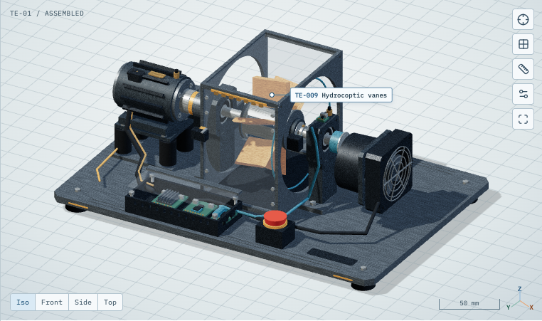
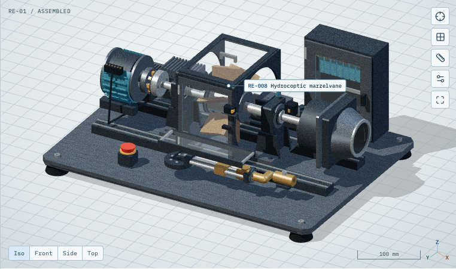
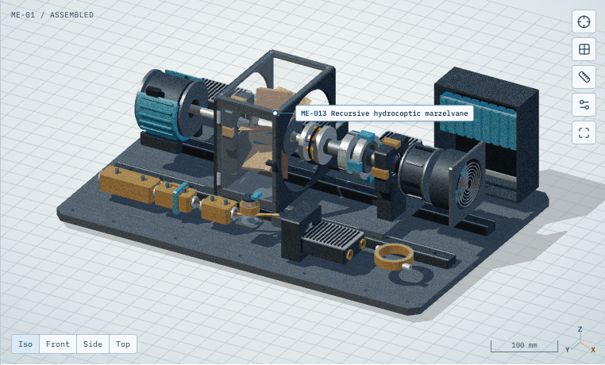

# Encabulator Systems

[Historical technical archive](https://rrg314.github.io/turbo-encabulator/#/archive) · [Assembly comparison](https://rrg314.github.io/turbo-encabulator/#/comparison) · [ME-01 host installation laboratory](https://rrg314.github.io/turbo-encabulator/#/me01/installation)

**Integrated Electromechanical Systems Engineering**

[](https://github.com/RRG314/turbo-encabulator/actions/workflows/deploy.yml) [](https://github.com/RRG314/turbo-encabulator/releases) [](LICENSE)

**[Open the engineering workbench](https://rrg314.github.io/turbo-encabulator/)** · [Configuration comparison](https://rrg314.github.io/turbo-encabulator/#/comparison) · [Reference library](engineering/REFERENCES.md) · [Citation](CITATION.cff)

An open electromechanical systems study with three independently parametrized FreeCAD models, traceable engineering records, and a static interactive test bench.

| Configuration | Mechanical and control basis | Technical package |
|---|---|---|
| **[Turbo Encabulator TE-01](https://rrg314.github.io/turbo-encabulator/#/explorer)** | Instrumented six-vane rotor, 24 V class drive, two 8 mm journals, flexible coupling and independent cooling. | [Master specification](docs/engineering/TE01_MASTER_SPEC.md) · [BOM](docs/engineering/bom.csv) · [CAD](cad/models/te01/) · [Downloads](https://rrg314.github.io/turbo-encabulator/#/engineering/downloads) |
| **[Retro Encabulator RE-01](https://rrg314.github.io/turbo-encabulator/#/re01/explorer)** | 48 V class industrial control architecture, 12 mm journals, six pitched marzelvanes, a compliant coupling and guided water-loop load. | [Technical manual](engineering/re01/MASTER_SPEC.md) · [Assembly hierarchy](engineering/re01/ASSEMBLY_HIERARCHY.md) · [CAD](cad/models/re01/) · [Downloads](https://rrg314.github.io/turbo-encabulator/#/re01/engineering/downloads) |
| **[Metachronic Encabulator ME-01](https://rrg314.github.io/turbo-encabulator/#/me01/explorer)** | 36 V class dual-shaft assembly with variable pitch, active radial stabilization, regenerative power management, and 21 scientific subsystem studies. | [Master specification](engineering/me01/MASTER_SPEC.md) · [Operating equations](engineering/me01/OPERATING_MODEL.md) · [CAD](cad/models/me01/) · [Downloads](https://rrg314.github.io/turbo-encabulator/#/me01/engineering/downloads) |

All three models support 3D selection by part number, scoped separation, cutaways, measurement, and model-specific service records. The operating console simulates drive response without a server. RE-01 adds a reduced-speed crank-slider and low-head fluid circuit. Read the [interchangeability study](engineering/INTERCHANGEABILITY.md), [historical source traceability](engineering/re01/SOURCE_TRACEABILITY.md), and [model limitations](engineering/re01/VALIDATION_MATRIX.md) when using results.

## Assembly illustrations

| Turbo Encabulator TE-01 | Retro Encabulator RE-01 | Metachronic Encabulator ME-01 |
|---|---|---|
|  |  |  |

[Power transfer and feedback diagram](docs/media/me01-power-and-feedback.svg) · [Canonical terminology](docs/engineering/terminology.md)

## Quick start

Node.js 22.12 or newer is required.

```sh
npm ci
npm run dev
```

Vite prints the local URL. WebGL 2 enables the CAD views. The parts hierarchy and schematic elevation remain available if graphics initialization fails.

## Layout and regeneration

The [historical register](data/archive/records.json) indexes source configurations separately from project CAD and numerical studies. The [source register](data/archive/sources.json) records publishers, dates, access and evidence scope. GE-62, CH-88, MI-16, ET-21 and MT-22 export from the shared [FreeCAD archive pipeline](cad/models/archive/). Generate the complete set with `python -m cad.models.archive.export` using a Python environment that can import FreeCAD and TechDraw. Pass a record ID to regenerate one configuration.

| Path | Role |
|---|---|
| `data/`, `data/re01/`, `data/me01/` | Machine-specific registries, interface links, assumed simulation inputs, and generated CAD placement data |
| `cad/`, `cad/models/` | Machine-specific solid geometry, CAD assembly, export and verification |
| `engineering/`, `docs/` | Design basis, source traceability, service, validation and research references |
| `src/machines/`, `src/simulation/` | Shared model bindings, solvers, and separate machine parameter sets |
| `public/models/` | Published neutral solids, browser meshes, drawings, BOM and verification reports |

Use `scripts/freecad.sh --mode all` for TE-01, `scripts/freecad-re01.sh` for RE-01, and `scripts/freecad-me01.sh` for ME-01. Set `TE01_FREECAD_PYTHON` to a FreeCAD-enabled interpreter where automatic macOS discovery is unavailable. [CAD generation and units](cad/README.md).

## Verification and deployment

Run `npm run lint`, `npm run typecheck`, `npm test`, `npm run test:browser`, and `npm run build`. Install Chromium for Playwright with `npx playwright install --only-shell chromium`. `TE01_WRITE_NUMERICAL=1 npm test` refreshes numerical evidence.

GitHub Actions publishes the validated static build to Pages. The workflow uses the configured repository base path and checks all three machine assets after deployment. Hash routes support browser reload and direct machine links. No repository secrets or backend are needed. Set `PAGES_BASE_PATH=/turbo-encabulator/` to reproduce the hosted build locally.

## Research and contributions

Start with the [contribution guide](CONTRIBUTING.md), [citation metadata](CITATION.cff), and [publication policy](SECURITY.md). The [implementation status](STATUS.md) records readiness and open decisions. Geometry, density estimates and test-bench results describe preliminary digital studies. Material specification, measured results, final protection, containment, tolerances and manufacturing release require further evidence.
