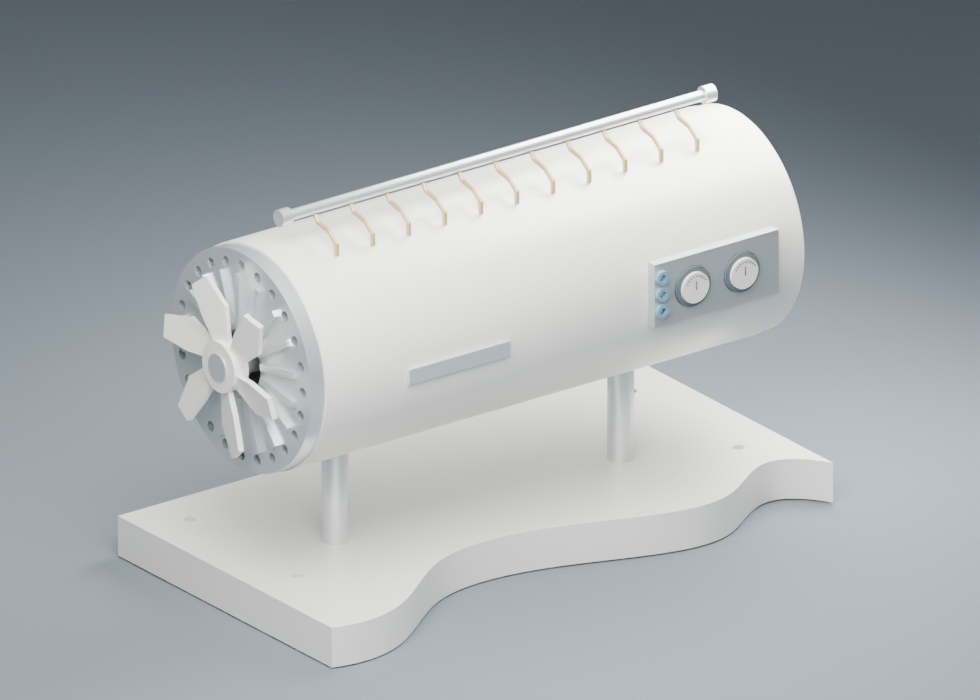
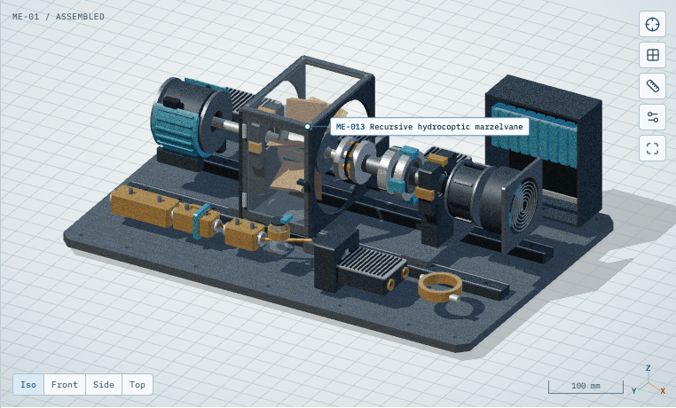
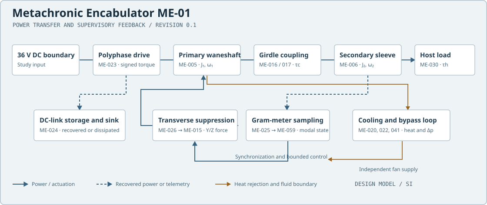
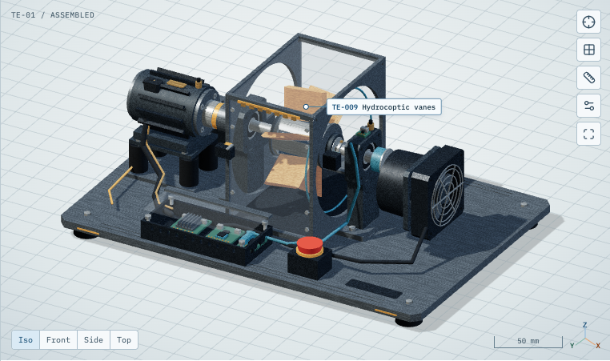
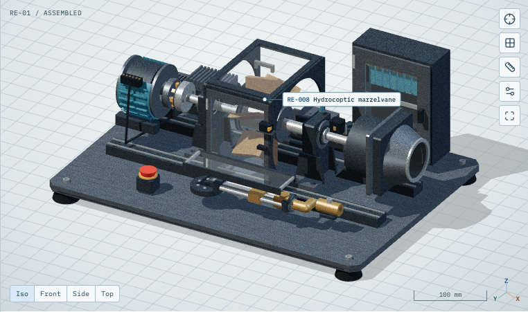

# Encabulator Lab 0.3.0

**Historical archive, explodable CAD, and operating laboratories**

The technical archive indexes **25 configurations and 35 sources**. Eight independently modeled CAD assemblies are available for inspection, including the TE-01, RE-01, and ME-01 engineering series and five source-traced reconstructions. Each live viewport includes source comparison, X-ray enclosure access, and assembled and exploded drawings.

 

[Technical archive](https://rrg314.github.io/encabulator-lab/#/archive) · [Source register](https://rrg314.github.io/encabulator-lab/#/archive/sources) · [Assembly comparison](https://rrg314.github.io/encabulator-lab/#/comparison) · [Reference library](https://github.com/RRG314/encabulator-lab/blob/1f794b77281a34a2de9f4519df111b7643a583c5/engineering/REFERENCES.md)

The repository and GitHub Pages workbench now use the Encabulator Lab name. In the workbench, choose a model from **View configuration**, use X-ray to inspect internal motion, and open **Test bench** to apply a simulated load. [TE-01 test bench](https://rrg314.github.io/encabulator-lab/#/simulation) · [RE-01 water-loop bench](https://rrg314.github.io/encabulator-lab/#/re01/simulation) · [ME-01 operating laboratory](https://rrg314.github.io/encabulator-lab/#/me01/simulation)

## Historical reconstructions

The five reconstructions include **70 part definitions and 268 placed instances**. Each includes assembled and exploded FreeCAD and STEP files, individual STEP/STL solids, a browser GLB, dimensioned SVG drawings, a bill of materials, and source traceability.

| Configuration | Reconstruction basis | Operating study |
|---|---|---|
| [General Electric Turboencabulator GE-62](https://rrg314.github.io/encabulator-lab/#/archive/ge-1962) | Cylindrical case, exposed end fan, scalloped base, crown tubing, and dual meters documented in figure 1 | Signed reactive current in a series RLC load |
| [Chrysler Turbo Encabulator CH-88](https://rrg314.github.io/encabulator-lab/#/archive/chrysler) | Ribbed bell casting and removable end cover with a project-defined coaxial fluid coupling | Input and turbine shaft response under load |
| [Micro Encabulator MI-16](https://rrg314.github.io/encabulator-lab/#/archive/micro-2016) | Hinged bench enclosure, lid instrumentation, and service harness | Capacitor charging and controlled discharge |
| [Electro Turbo Encabulator ET-21](https://rrg314.github.io/encabulator-lab/#/archive/electro-2021) | Instrument chassis, coaxial ports, acquisition board, and paired resonator stages | Cascaded frequency response |
| [Magneto-Turboencabulator MT-22](https://rrg314.github.io/encabulator-lab/#/archive/magneto-2022) | Lobed carriers, satellite disks, outboard indication, and a nominal independent carrier sleeve | Periodic magnetic torque transfer between two shafts |

*GE-62 revision 0.4. Figure 1 supports the base-to-support proportions and five external fan blades. Page 802 specifies six internal vanes and forty-seven brushes, which are included with nominal tremie feed geometry. The nominal assembled envelope is 371.12 × 202.39 × 240.00 mm. Historical scale remains unverified.* [1962 GE catalog figure](https://commons.wikimedia.org/wiki/File:GE_Turboencabulator_pg_1.jpg) · [1962 handbook continuation](https://commons.wikimedia.org/wiki/File:GE_Turboencabulator_pg_2.jpg) · [Dimensional evidence and verification](https://github.com/RRG314/encabulator-lab/blob/main/engineering/GE62_DIMENSION_AUDIT.md)

*MT-22 separated assembly. The drawing dimensions describe the nominal reconstruction.*

## Operating studies and comparison

The expanded register includes the Illinois Mini Encabulator schematic, documented builds by Captain Jerry and Ian Davis, and additional published variants. The configuration selector opens CAD, operating studies or source records. Reuse permissions and source requirements are recorded in the [configuration contribution form](https://github.com/RRG314/encabulator-lab/issues/new?template=encabulator-configuration.yml).

The archive provides nine browser-based studies. Alongside the five reconstruction studies, the [Cryptoencabulator](https://rrg314.github.io/encabulator-lab/#/archive/crypto-2019/study) tracks state occupancy and recirculation, the [SANS ICS HyperEncabulator](https://rrg314.github.io/encabulator-lab/#/archive/hyper-2022/study) illustrates a sensor-freshness interlock, the [SD-WAN Turbo Cloud Encabulator](https://rrg314.github.io/encabulator-lab/#/archive/cloud-2018/study) models traffic delivery during link transfer, and the [Mini Encabulator](https://rrg314.github.io/encabulator-lab/#/archive/mini-2022/study) animates the reference circuit’s LED. The rotary and electrical studies replay calculated shaft angles and excitation on the CAD assemblies. The TE-01 and RE-01 benches support a dynamometer brake, blower, or generator load bank.

The [assembly comparison workbench](https://rrg314.github.io/encabulator-lab/#/comparison) displays two or three configurations with shared camera orientation and separation distance. The [ME-01 installation laboratory](https://rrg314.github.io/encabulator-lab/#/me01/installation) compares a direct-drive reference and two pitch settings across six modeled host loads. Mechanical host adapters, mounts, and containment remain open.

## TE-01, RE-01, and ME-01 engineering series

| Configuration | Electrical basis | Mechanical scope |
|---|---|---|
| [Turbo Encabulator TE-01](https://rrg314.github.io/encabulator-lab/#/engineering/downloads) | 24 V class | Guarded six-vane rotor, twin journal stations, independent cooling, and phase acquisition |
| [Retro Encabulator RE-01](https://rrg314.github.io/encabulator-lab/#/re01/engineering/downloads) | 48 V class | Opposed 12 mm journals, guarded crank-slider, and metered one-direction water loop |
| [Metachronic Encabulator ME-01](https://rrg314.github.io/encabulator-lab/#/me01/engineering/downloads) | 36 V class | Dual concentric shafts, variable-pitch vanes, radial stabilization, and regenerative DC storage |

The [ME-01 operating laboratory](https://rrg314.github.io/encabulator-lab/#/me01/simulation) couples shaft speed, vane pitch, current, heat rejection, flow, and radial response. The [scientific subsystem register](https://rrg314.github.io/encabulator-lab/#/me01/systems) contains 21 studies. The engineering register contains 52 records, including 41 physical definitions and 11 controller computations.

| Turbo Encabulator TE-01 | Retro Encabulator RE-01 |
|---|---|
|  |  |

## Verification and downloads

The assembly audit covers **189 physical part definitions, 442 placed instances, 189 component sheets, and 16 assembly drawings** across eight CAD models. FreeCAD and STEP round trips retain individual solid counts and placement within the report tolerances. The five reconstructions passed static interference checks at the assembled and fully separated positions. Swept clearances and physical qualification remain open. The engineering series retains 28 TE-01, 31 RE-01, and 23 ME-01 assembled-contact findings for disposition. [CAD audit](https://rrg314.github.io/encabulator-lab/models/assembly-conformance.json) · [Engineering status](https://github.com/RRG314/encabulator-lab/blob/main/STATUS.md)

The reconstruction dimensions are project-defined. Published trajectories and readings are calculated. Source records with insufficient reconstruction evidence retain their documented scope. Strategic Learning remains a research lead pending an attributable publication.

The [source conformance report](https://rrg314.github.io/encabulator-lab/models/source-conformance.json) lists measured CAD dimensions alongside published requirements. The TE-01 and RE-01 foundation trim is recessed to hold the stated baseplate envelopes.

Lint, TypeScript, the production build, 58 unit tests, 14 browser tests and GitHub Pages deployment passed. [Verification run](https://github.com/RRG314/encabulator-lab/actions/runs/44146084485)

Eight engineering packages accompany this draft. Use the attached SHA-256 manifest to verify each archive. [Contribution guide](https://github.com/RRG314/encabulator-lab/blob/main/CONTRIBUTING.md) · [Citation metadata](https://github.com/RRG314/encabulator-lab/blob/main/CITATION.cff)
